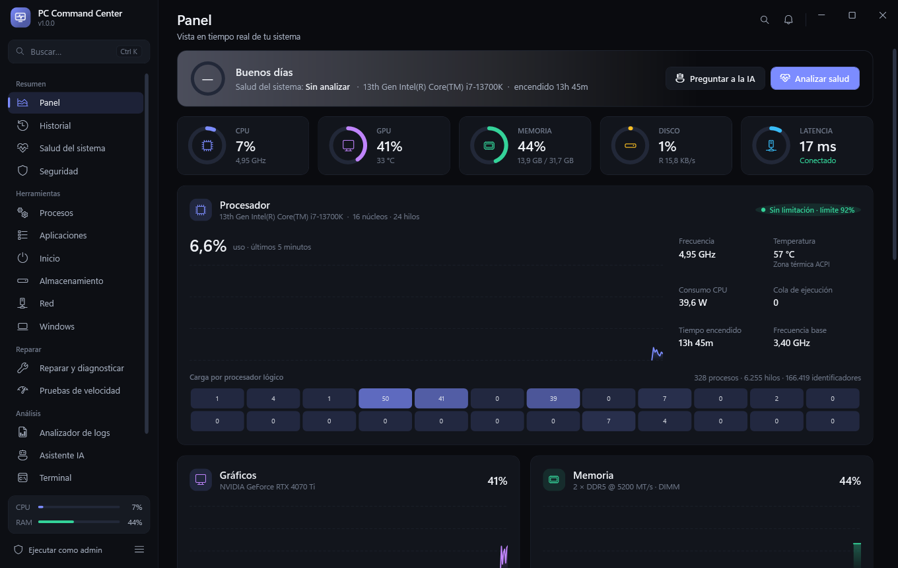
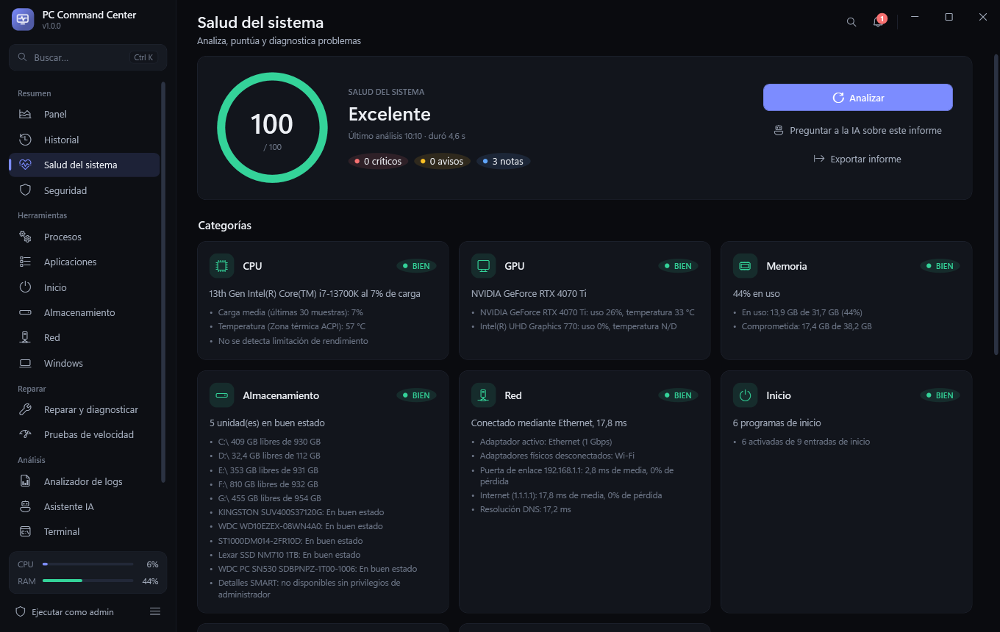
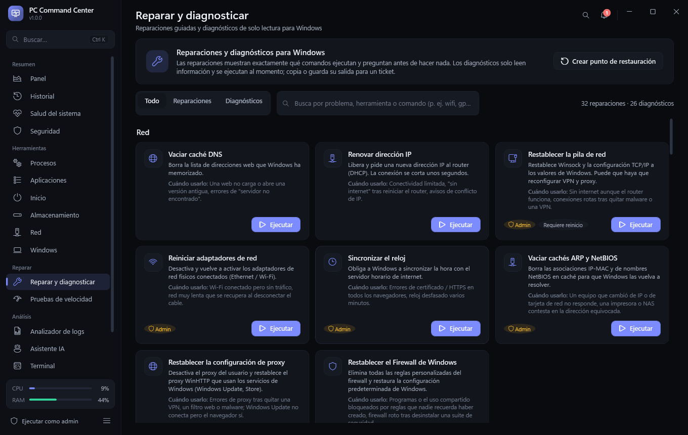
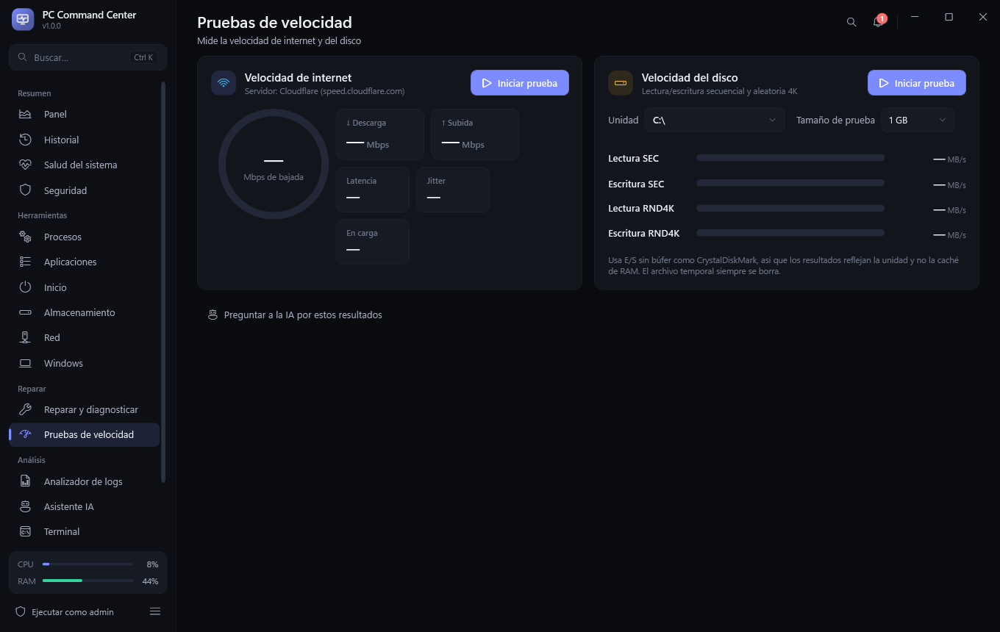

# PC Command Center

**Your PC. One dashboard.** A free, open-source control and diagnostics center for Windows 10/11:
live monitoring, health score, security status, guided repairs, IT diagnostics, speed tests and an AI assistant,
in one fast, modern app. English and Spanish.

[](https://github.com/asierdeltoya/pc-command-center/releases/latest)




## Download

Get the latest version from **[Releases](https://github.com/asierdeltoya/pc-command-center/releases/latest)**:

* `PCCommandCenter-Setup.exe` — installer (no administrator rights needed, clean uninstall).
* `PCCommandCenter.exe` — portable, single file, nothing to install.

No .NET installation is required. Windows SmartScreen may warn the first time because the executable is not code-signed:
click *More info → Run anyway*.

## Principles

* **Real data only.** Every value is read from Windows; when something cannot be measured the app says *Not available* instead of guessing.
* **Nothing runs behind your back.** Repairs show the exact commands and ask first; nothing is deleted automatically.
* **Light.** Around 0.2 % CPU with the dashboard open, less in the tray.

| | |
|---|---|
|  |  |
| **System health** — score, real problems, HTML report for a technician | **Repair & diagnose** — 32 guided repairs and 26 read-only diagnostics |



## En español

PC Command Center es un centro de control y diagnóstico para Windows 10/11, gratuito y de código abierto. Incluye:
monitorización en tiempo real e historial de 7 días, puntuación de salud con informe exportable, estado de seguridad,
gestor de procesos, aplicaciones (desinstalar y actualizar con winget), inicio, almacenamiento, herramientas de red,
**32 reparaciones guiadas y 26 diagnósticos para informáticos**, pruebas de velocidad de internet y disco, analizador de logs,
terminal y asistente de IA. La interfaz sigue el idioma de Windows y se puede cambiar en *Configuración → Apariencia*.
Descárgalo desde **[Releases](https://github.com/asierdeltoya/pc-command-center/releases/latest)**.

## Pages

| Group | Page | What it does |
|---|---|---|
| Overview | Dashboard | Live CPU, GPU, RAM, disk, network and latency with charts |
| | History | One point per minute kept for 7 days: CPU (average and peak), RAM, GPU, temperatures, disk, network, latency — "what was my PC doing last night?" |
| | System Health | 0–100 score, real problems with a fix button for each, **Export report** (self-contained HTML to send to a technician) |
| | Security | Antivirus, real-time protection, definitions, last scan, firewall, Windows Update, UAC, Secure Boot, BitLocker, Remote Desktop, SMBv1, activation; Defender quick scan |
| Tools | Processes, Startup, Storage, Network, Windows | Process manager, startup entries, disk analyzer and cleanup, network tools, Windows tools, services, events, **power plan and battery health** |
| | Apps | Every installed program with icon, size and date; uninstall; **updates through winget** (one or all) |
| Repair | Repair & diagnose | **32 guided repairs** (network: DNS, IP, Winsock/TCP-IP, adapters, ARP/NetBIOS, proxy, firewall, clock · Windows: SFC, DISM, CHKDSK scan/fix, Windows Update cache and full reset, WMI, Search index, Start menu, WinSxS cleanup · domain: gpupdate, Kerberos purge, DNS registration, local GPO reset, re-enable Task Manager/regedit/CMD · apps: OneDrive, Teams, Store · devices: audio, Bluetooth, print queue, hardware rescan). Each shows its exact commands, asks first, and offers a restore point.<br>**26 read-only diagnostics** that run without confirmation: ipconfig /all, Wi-Fi signal and WLAN report, routes, proxy, hosts, dsregcmd, whoami, gpresult, local admins, BSOD history, shutdown/restart events (41/6008/1074), problem devices, drivers, sleep blockers, energy report, installed KBs, DISM CheckHealth, license, BitLocker, TPM, BCD, systeminfo, non-Microsoft tasks and services, Defender exclusions. Search by problem or command, filter repairs/diagnostics, copy or save the output for a ticket; every item is also in Ctrl+K |
| | Speed Tests | Internet (Cloudflare: download, upload, latency, jitter, latency under load / bufferbloat) and disk (unbuffered SEQ and RND4K read/write, like CrystalDiskMark), with a plain-language verdict |
| Analysis | Log Analyzer, AI Assistant, Terminal | Log analysis, Claude assistant with "Send to AI" from every page, CMD/PowerShell |

## Building from source

Requirements: Windows 10/11 x64, the [.NET 10 SDK](https://dotnet.microsoft.com/download) and, for the installer, [Inno Setup 6](https://jrsoftware.org/isinfo.php).

```powershell
dotnet build PCCommandCenter.sln -c Debug       # build
dotnet run --project src\PCCommandCenter.App    # run
powershell -ExecutionPolicy Bypass -File build-release.ps1   # installer + portable exe in dist\
```

## Deliverables (`dist\`)

| File | What it is |
|---|---|
| `PCCommandCenter-Setup.exe` | Installer (Inno Setup). Per-user install without admin by default (option for all users), Start-menu + optional desktop shortcut, registered in *Installed apps*, clean uninstall (closes the app in the tray, removes the auto-start entry). |
| `PCCommandCenter.exe` | Portable single-file build. Self-contained: no .NET installation required. |
| `app\` | Self-contained folder build used by the installer. |

Rebuild everything with `powershell -ExecutionPolicy Bypass -File build-release.ps1` (needs the .NET 10 SDK and Inno Setup 6).

## Architecture

```
src/
  PCCommandCenter.Core          models, service interfaces, logging (app.log), localization, formatting
  PCCommandCenter.Settings      settings.json, DPAPI secret store (API key), Windows auto-start
  PCCommandCenter.Hardware      CPU / GPU / RAM / disk / network telemetry on a background thread
  PCCommandCenter.Network       ping, DNS (DnsQuery), traceroute, ARP, interfaces, TCP/UDP tables, connectivity monitor
  PCCommandCenter.Processes     NtQuerySystemInformation process table, per-process CPU / I/O, termination
  PCCommandCenter.Storage       parallel disk scanner, cleanup (temp files, Recycle Bin), recycle single files
  PCCommandCenter.WindowsTools  tool launcher, services, event log, startup entries, shell (CMD/PowerShell)
  PCCommandCenter.AI            Claude assistant via the official Anthropic SDK (streaming)
  PCCommandCenter.Diagnostics   System Health scoring, log analyzer (text, CSV, JSON lines, .evtx)
  PCCommandCenter.App           WPF shell, MVVM view models, views, charts, tray, command palette, notifications
```

Every module depends only on `Core` interfaces; the App wires them with dependency injection, so new modules can be added
without touching the others.

## Where the data comes from (nothing is simulated)

* **CPU** – `Processor Information` counters (utility, per-core, actual frequency, `% Performance Limit`), `Thermal Zone Information`
  (ACPI zones; not always the CPU die), `Energy Meter` RAPL package power, processor queue length.
* **GPU** – DXGI adapters (name, real VRAM size), `GPU Engine` / `GPU Adapter Memory` counters for any vendor;
  NVIDIA NVML for temperature, clocks, power, fan and throttle reasons.
* **Memory** – `GlobalMemoryStatusEx`, `GetPerformanceInfo` (commit, cache), WMI `Win32_PhysicalMemory`.
* **Storage** – `PhysicalDisk` counters, `MSFT_PhysicalDisk` health, reliability counters and SMART failure prediction.
* **Network** – IP Helper API (default route, TCP/UDP owner tables, ARP), ICMP, `DnsQuery_W` with cache bypass.
* **Security** – `SecurityCenter2` products, Defender `MSFT_MpComputerStatus`, firewall policy registry, Windows Update COM history,
  UAC / RDP / SMBv1 registry, Secure Boot state, BitLocker shell property, `SoftwareLicensingProduct`.
* **Apps** – the Uninstall registry keys (64-bit, 32-bit, per-user) and `winget upgrade`.
* **Battery / power** – `powercfg`, `Win32_Battery`, `BatteryStaticData` / `BatteryFullChargedCapacity` (design vs. current capacity).
* **Speed tests** – `speed.cloudflare.com` (latency corrected with the server's own `Server-Timing`); disk test uses
  `FILE_FLAG_NO_BUFFERING | WRITE_THROUGH` on a temporary file that is always deleted.

### Shown as "Not available" by design
* CPU die temperature (needs a kernel sensor driver; the ACPI thermal zone is shown and labelled as such).
* Temperature / clocks / power of non-NVIDIA GPUs.
* SMART details and drive temperature when not running as administrator (use *Run as admin*).
* Per-process network bandwidth (Windows only exposes it through kernel tracing) — the table shows established connections.
* Startup "impact" (Windows does not expose Task Manager's measurement).

## Safety
Nothing destructive runs automatically. Ending processes (extra acknowledgement for critical Windows processes), changing services,
toggling startup entries, deleting/recycling files and terminal commands that can modify the system all require confirmation.
AI-suggested commands are only pre-filled in the terminal. The Anthropic API key is encrypted with Windows DPAPI.

## Files
* Settings: `%LOCALAPPDATA%\PCCommandCenter\settings.json`
* Encrypted secrets: `%LOCALAPPDATA%\PCCommandCenter\secrets.dat`
* Log: `%LOCALAPPDATA%\PCCommandCenter\logs\app.log`
* History: `%LOCALAPPDATA%\PCCommandCenter\history.dat` (binary, 7 days, a few MB at most)

## Command-line switches
* `--tray` start hidden in the notification area (used by *Start with Windows*)
* `--shutdown` ask a running instance to exit cleanly
* `--qa-capture <folder> [functional] [palette]` render every page (and optionally run the real tools) to PNG files for visual QA

## License

[MIT](LICENSE)
